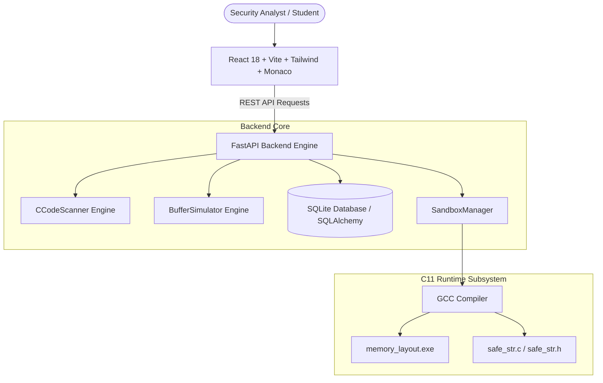

# BufferGuard – Buffer Overflow Detection, Simulation & Prevention System

<p align="center">
  
</p>

<p align="center">
  <strong>Comprehensive Full-Stack Cybersecurity Laboratory, C Source Vulnerability Scanner, and Interactive Memory Visualizer.</strong>
</p>

<p align="center">
  
  
  
  
  
</p>

---

## 🛡️ Project Overview

**BufferGuard** is a college-level, production-grade cybersecurity application engineered to demonstrate how memory-safety violations (specifically buffer overflows) occur in C programs, how they manipulate virtual memory, and how developers can systematically prevent them using defensive APIs and modern compiler mitigations.

### Key Capabilities
- **Buffer Overflow Simulator:** Interactive byte-level grid modeling capacity boundaries, character writes, null termination (`\0`), and out-of-bounds stack corruption with adjustable animation speeds.
- **C Code Vulnerability Scanner:** Static analysis engine that parses C source code for obsolete and dangerous library calls (`gets`, `strcpy`, `strcat`, `sprintf`, `scanf %s`), direct out-of-bounds indexing, and off-by-one loops (`<= SIZE`), providing line numbers, CWE mappings, and safer code diffs.
- **Live Memory Visualizer:** Low-level architectural diagram of virtual memory segments (Text, Data, BSS, Heap, Stack), activation frames, stack canaries, and return address hijacking.
- **Secure Coding Playground:** Sandboxed C development environment with Monaco Editor, live syntax checking (`gcc -fsyntax-only`), and safe educational execution.
- **Vulnerability Report Generator:** Export formal security audit reports in PDF, JSON, and CSV formats based on real scan findings.
- **Cybersecurity Learning Center:** 14 structured educational lessons with interactive quizzes and instant feedback.
- **C11 Defensive String Engine:** Standalone C11 safe string library (`safe_str.c`) providing capacity-checked, null-termination guaranteed string handling.

---

## 🏗️ System Architecture



---

## 💻 Tech Stack

- **Frontend:** React 18, Vite 5, TypeScript 5, Tailwind CSS 3, Monaco Editor (`@monaco-editor/react`), Recharts, Framer Motion, Lucide React, Axios.
- **Backend:** Python 3.13, FastAPI, Pydantic v2, SQLAlchemy ORM, SQLite 3.
- **Core Engine:** ISO C11 Standard, MinGW GCC, GNU Make.
- **DevOps & QA:** Pytest (14/14 tests passing), Docker, Docker Compose.

---

## 📁 Project Folder Structure

```text
BufferGuard/
├── backend/                  # FastAPI backend server
│   ├── app/
│   │   ├── api/              # REST route controllers (dashboard, scanner, simulator, playground, reports, analytics, learning)
│   │   ├── database/         # SQLite database session and connection setup
│   │   ├── models/           # SQLAlchemy ORM schemas
│   │   ├── schemas/          # Pydantic validation models
│   │   ├── security/         # SandboxManager and host isolation policies
│   │   ├── services/         # CCodeScanner, BufferSimulator, ReportGenerator
│   │   └── main.py           # FastAPI entrypoint and lifespan seed handler
│   ├── tests/                # 14 comprehensive Pytest test suites
│   └── requirements.txt
│
├── frontend/                 # React 18 + TypeScript frontend
│   ├── src/
│   │   ├── components/       # MemoryGrid, VulnerabilityCard, StatsCard, Sidebar, Header
│   │   ├── layouts/          # Main responsive layout
│   │   ├── pages/            # 10 dedicated application pages
│   │   ├── services/         # Axios API client
│   │   ├── types/            # TypeScript interfaces
│   │   └── styles/           # Tailwind CSS directives
│   ├── package.json
│   └── vite.config.ts
│
├── c_engine/                 # Low-level C11 memory engine
│   ├── examples/             # Vulnerable & secure educational C benchmark programs
│   ├── memory_demo/          # memory_layout.c low-level process address inspector
│   ├── safe_functions/       # safe_str.c and safe_str.h defensive string library
│   ├── tests/                # test_safe_str.c unit tests (19/19 passing)
│   └── Makefile              # GNU build targets
│
├── docs/                     # University documentation and specifications
│   ├── architecture.md       # Multi-tiered system design & diagrams
│   ├── api.md                # Full REST API specifications
│   ├── security.md           # Sandboxing & host isolation principles
│   └── project_report.md     # 20-section Academic Capstone Project Report
│
├── scripts/                  # One-click Windows launch and test batch scripts
├── docker/                   # Dockerfiles and docker-compose.yml
└── README.md
```

---

## 🚀 Getting Started

### Prerequisites
1. **Python 3.10+** (Python 3.13 verified)
2. **Node.js 18+** (Node v26 verified)
3. **GCC Compiler** (MinGW / GCC with C11 support)

---

### Step 1: Backend Setup

```bash
cd backend

# Install Python dependencies
pip install -r requirements.txt

# Run backend unit test suite
python -m pytest -v

# Start FastAPI server
python -m uvicorn backend.app.main:app --host 0.0.0.0 --port 8000 --reload
```
*Backend runs at: `http://localhost:8000` (API Docs at `http://localhost:8000/docs`)*

---

### Step 2: Frontend Setup

```bash
cd frontend

# Install Node dependencies
npm install

# Build production bundle
npm run build

# Start Vite development server
npm run dev
```
*Frontend runs at: `http://localhost:5173`*

---

### Step 3: C Engine Build & Tests

```bash
cd c_engine

# Compile safe string library and run unit tests
gcc -std=c11 -Wall -Wextra tests/test_safe_str.c safe_functions/safe_str.c -o bin/test_safe_str.exe
./bin/test_safe_str.exe

# Run memory layout inspector
gcc -std=c11 memory_demo/memory_layout.c -o bin/memory_layout.exe
./bin/memory_layout.exe "DEMO_INPUT"
```

---

## 🧪 Testing Summary

- **Backend Pytest:** 14/14 tests pass (`tests/test_api.py`, `tests/test_scanner.py`, `tests/test_simulator.py`).
- **C Engine Tests:** 19/19 unit tests pass in `c_engine/tests/test_safe_str.c` (100% boundary check and null termination validation).
- **Frontend Build:** `vite build` transforms 2606 modules with 0 errors.

---

## 🔒 Security Sandbox Note

BufferGuard enforces strict host isolation. Arbitrary user-supplied C binaries are **never** executed on the host server. Arbitrary code is checked for grammar via `gcc -fsyntax-only` and statically inspected using `CCodeScanner`. Runtime execution is restricted to verified educational benchmark templates under 3-second runtime limits.

---

## 📜 Academic License

Developed for educational demonstration, viva defense, and research in computer memory safety under the MIT License.
