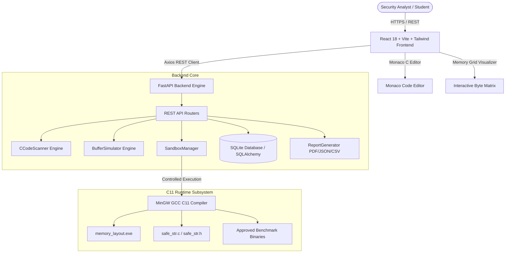
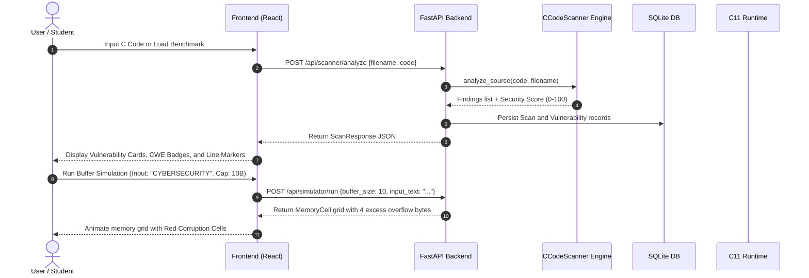
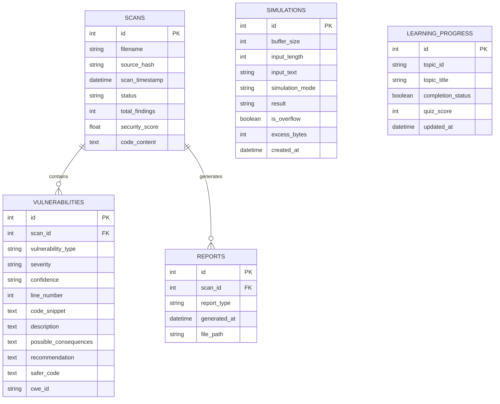

# BufferGuard – System Architecture & Technical Design

## 1. System Overview

**BufferGuard** is an interactive cybersecurity research, simulation, and prevention platform engineered to illustrate how buffer overflows occur in the C programming language, how they impact low-level computer memory, and how software engineers can systematically detect and prevent them.

The system decouples presentation, static analysis orchestration, and low-level C compilation into three cooperating layers:

---

## 2. Component Architecture

### 2.1 Frontend Presentation Tier
- **Framework:** React 18.3 with TypeScript and Vite 5.4.
- **Styling:** Tailwind CSS with dark-theme glassmorphism, responsive navigation drawer, and custom status pills.
- **Editor:** Integrated Monaco Editor with C language syntax highlighting, line jump indicators, and live editing.
- **Visuals:** Animated memory cell grid (`MemoryGrid.tsx`) with byte hex offsets, boundary markers, and out-of-bounds corruption highlights.
- **Telemetry:** Recharts data visualizations showing security score trends, CWE frequency, and safe vs. vulnerable program ratios.

### 2.2 Backend Orchestration Tier
- **Framework:** Python 3.13 with FastAPI.
- **Persistence:** SQLite 3 with SQLAlchemy ORM (models: `Scan`, `Vulnerability`, `Simulation`, `Report`, `LearningProgress`).
- **Static Analysis Engine (`CCodeScanner`):** Context-aware lexical scanner identifying dangerous calls (`gets`, `strcpy`, `strcat`, `sprintf`, `%s` in `scanf`), array out-of-bounds indices, and loop off-by-one errors (`<= SIZE`).
- **Simulation Engine (`BufferSimulator`):** Simulates byte write operations into bounded memory arrays, models null terminator behavior (`\0`), and computes exact excess corruption bytes.
- **Security Sandbox (`SandboxManager`):** Enforces host machine isolation by rejecting arbitrary user code execution while enabling safe syntax verification (`-fsyntax-only`) and running strictly pre-approved educational benchmarks.

### 2.3 C11 Core Engine Tier
- **Language Standard:** ISO C11 (`-std=c11`).
- **Safe String Library (`safe_str.c`):** Provides safe replacements for standard C string operations:
  - `safe_strcpy()`: Bounds-enforced copy with guaranteed null termination.
  - `safe_strcat()`: Capacity-aware string concatenation.
  - `safe_readline()`: Safe stream input reading replacing `gets()` and `scanf("%s")`.
  - `safe_check_bounds()`: Array index validation.
- **Low-Level Memory Inspector (`memory_layout.c`):** Direct process inspection dumping addresses for text, data, bss, heap, and stack segments, frame pointers, and canary sentinels in JSON format.

---

## 3. Data Flow Diagram

---

## 4. Database Entity-Relationship (ER) Schema

