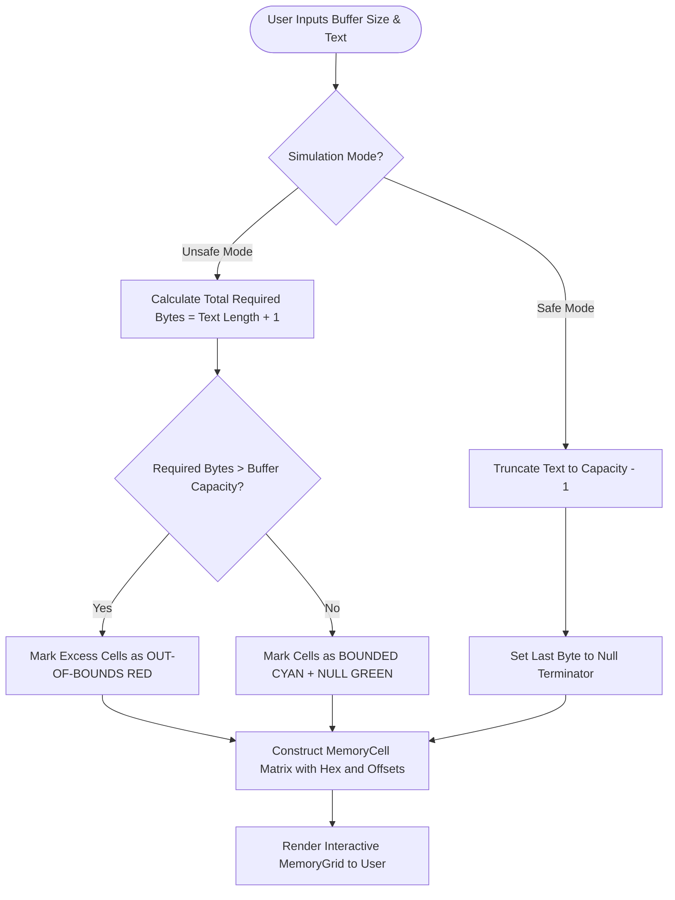

# BufferGuard: Buffer Overflow Detection, Simulation & Prevention System
## Academic Capstone Project Report & Technical Viva Documentation

---

### Table of Contents
1. Abstract
2. Introduction
3. Problem Statement
4. Objectives
5. Literature Review
6. Existing Systems
7. Proposed System
8. System Architecture
9. Technologies Used
10. Methodology
11. Implementation Details
12. Algorithms
13. System Flowcharts & Workflow Diagrams
14. Database Design & Entity Relationships
15. Testing & Verification Results
16. Results & Discussion
17. Limitations
18. Future Scope
19. Conclusion
20. References

---

### 1. Abstract
Memory-safety vulnerabilities—predominantly buffer overflows in the C and C++ programming languages—have constituted one of the most critical classes of software security flaws for more than three decades. Despite modern mitigations like Address Space Layout Randomization (ASLR) and stack canaries, legacy codebases and resource-constrained embedded systems continue to suffer from memory corruption.

This project introduces **BufferGuard**, a full-stack, modular cybersecurity education, simulation, and prevention platform. BufferGuard combines an interactive visual memory simulator, an automated context-aware C source vulnerability scanner, an interactive low-level memory visualizer, and a C11 defensive string library (`safe_str.c`). Developed with a FastAPI REST backend, a React/TypeScript/Tailwind frontend, and SQLite persistence, BufferGuard bridges theoretical computer architecture concepts with practical secure coding pedagogy.

---

### 2. Introduction
The C programming language remains the foundation of modern operating system kernels, device drivers, embedded microcontrollers, and high-performance computing runtimes. Unlike modern managed runtimes (such as Java, C#, or Python), C provides raw pointer arithmetic and direct memory manipulation without automatic array boundary enforcement.

When an application attempts to write more data into a contiguous memory buffer than its declared capacity, the surplus bytes spill into adjacent memory. This out-of-bounds write can overwrite neighboring variables, corrupt stack frame pointers, alter the CPU return instruction pointer (EIP/RIP), and lead to arbitrary code execution or denial of service.

BufferGuard provides an intuitive, interactive environment for university students and security engineers to understand these low-level dynamics visually, analyze vulnerable C code, and implement provably safe remediations.

---

### 3. Problem Statement
Traditional approaches to teaching memory safety suffer from significant pedagogical hurdles:
1. **Abstract Complexity:** Students struggle to conceptualize how contiguous byte arrays map to stack frames, saved registers, and heap chunks.
2. **Crash Invisibility:** Undefined behavior in C often leads to silent corruption or erratic crashes without clear explanatory feedback.
3. **Execution Risks:** Executing malicious C buffer overflow exploits on shared university lab computers risks host compromise, system crashes, and denial of service.
4. **Lack of Automated Guidance:** Static linters often output cryptic compiler warnings without demonstrating concrete, safer alternative implementations.

---

### 4. Objectives
The core objectives of BufferGuard include:
- **Interactive Visual Simulation:** Model fixed-size character buffers in memory, demonstrating valid byte writes, null terminator placement (`\0`), and out-of-bounds corruption in real time.
- **Context-Aware Static Analysis:** Develop a C code scanner capable of identifying dangerous API usage (`gets`, `strcpy`, `strcat`, `sprintf`, `%s` in `scanf`) and distinguishing between confirmed overflows and safe operations.
- **Low-Level Memory Architecture Visualization:** Illustrate the segmentation of process address space (Text, Data, BSS, Heap, Stack) and visualize how stack-smashing attacks hijack CPU control flow.
- **Defensive Engineering Implementation:** Provide a production-grade, C11-compliant safe string library (`safe_str.c`) providing capacity-aware copying and concatenation.
- **Automated Security Reporting & Learning:** Generate downloadable audit reports (PDF, JSON, CSV) and provide 14 structured educational lessons with interactive quizzes.

---

### 5. Literature Review
The seminal work *Smashing the Stack for Fun and Profit* by Aleph One (Phrack, 1996) formally detailed the mechanics of stack-based buffer overflows. Over the ensuing decades, research focused on hardware and compiler mitigations:
- **Stack Canaries (Cowan et al., 1998):** Sentinel values placed on the stack before the return pointer to detect corruption.
- **Non-Executable Memory / W^X (PaX Project, 2000):** Hardware data execution prevention (DEP/NX) ensuring writable memory is not executable.
- **Address Space Layout Randomization (ASLR):** Randomizing memory base offsets to prevent fixed-address exploitation.
- **AddressSanitizer (Serebryany et al., 2012):** Compiler-assisted memory error detection using shadow memory and redzones with minimal runtime overhead.

---

### 6. Existing Systems
| System | Strengths | Limitations |
|---|---|---|
| **Valgrind (Memcheck)** | Deep dynamic memory instrumentation | Heavy CPU slowdown (~20x-50x); difficult for beginners to interpret. |
| **GDB / GEF** | Low-level register and memory inspection | Steep CLI learning curve; lacks web-based interactive visual modeling. |
| **Flawfinder / Cppcheck** | Command-line static analysis | Static output; does not visually demonstrate live memory corruption. |
| **Online C Compilers (Godbolt)** | Fast compilation and assembly inspection | Lacks dedicated cybersecurity exploit modeling and guided remediation. |

---

### 7. Proposed System (BufferGuard)
BufferGuard integrates the best aspects of static analysis, visual simulation, and low-level memory tracing into a unified web application:
- Real-time interactive byte matrix showing character hex values, boundaries, and excess byte calculations.
- Context-aware scanner with line-numbered code snippets, CWE classifications, and one-click fix copying.
- Sandboxed backend architecture preventing arbitrary host code execution.
- 14 interactive learning modules covering fundamental memory layout to modern mitigations.

---

### 8. System Architecture
BufferGuard utilizes a 3-tier architecture:
1. **Frontend (React 18 + TypeScript + Vite):** Modern responsive UI with dark theme, Monaco Editor, and Recharts.
2. **Backend (Python 3.13 + FastAPI):** Asynchronous REST API orchestrating static analysis, simulation, and report generation.
3. **Core Engine (C11 + GCC):** Controlled memory inspection binary (`memory_layout.exe`) and safe string library (`safe_str.c`).

---

### 9. Technologies Used
- **Frontend:** React 18, TypeScript, Tailwind CSS, Monaco Editor, Recharts, Lucide React, Axios.
- **Backend:** Python 3.13, FastAPI, Pydantic v2, SQLAlchemy ORM, SQLite 3.
- **Core C Engine:** ISO C11 standard, MinGW GCC, GNU Make.
- **DevOps & QA:** Pytest, Vitest, Docker, Git.

---

### 10. Methodology
The development followed an agile, phased methodology:
1. **Phase 1: Architecture & Requirements Definition**
2. **Phase 2: Core C Engine & Safe String Implementation**
3. **Phase 3: Backend REST Services & Static Analysis Heuristics**
4. **Phase 4: Frontend UI, Memory Matrix, & Monaco Integration**
5. **Phase 5: System Verification, Unit Testing, & Sandbox Hardening**

---

### 11. Implementation Details

#### C11 Safe String Copy (`safe_str.c`)
```c
SafeStrStatus safe_strcpy(char *dest, size_t dest_size, const char *src) {
    if (!dest || !src) return SAFE_STR_NULL_PTR;
    if (dest_size == 0) return SAFE_STR_ZERO_SIZE;

    size_t i = 0;
    while (i < dest_size - 1 && src[i] != '\0') {
        dest[i] = src[i];
        i++;
    }
    dest[i] = '\0'; // Guaranteed null termination
    return (src[i] != '\0') ? SAFE_STR_TRUNCATED : SAFE_STR_OK;
}
```

---

### 12. Algorithms

#### 12.1 Static Vulnerability Detection Algorithm
```
Input: C source code string S, filename F
Output: Findings list L, Security Score (0-100)

1. Parse S line by line; strip comments.
2. Identify buffer declarations: char name[SIZE] -> store in DeclaredBuffers map.
3. For each line in S:
     If line matches gets(dest) -> Flag Critical (CWE-120)
     If line matches strcpy(dest, literal) and strlen(literal) >= DeclaredBuffers[dest]:
         Flag Confirmed Critical (CWE-121)
     If line matches strcpy(dest, var) -> Flag Potential High (CWE-120)
     If line matches for (i=0; i <= BOUND; i++) -> Flag Potential Off-by-One (CWE-193)
     If line matches direct index [K] >= SIZE -> Flag Critical (CWE-787)
4. Compute SecurityScore = max(0, 100 - sum(Penalties))
5. Return L, SecurityScore
```

---

### 13. System Flowcharts & Workflow Diagrams

#### Buffer Overflow Simulation Flowchart


---

### 14. Database Design & Entity Relationships
- **scans:** Primary table storing scan metadata, filename, timestamp, and score.
- **vulnerabilities:** Relational child table storing type, severity, line number, CWE ID, and code diff.
- **simulations:** Audit log storing buffer parameters, input text, and overflow outcome.
- **reports:** Generated audit artifacts (PDF, JSON, CSV) mapped to parent scans.
- **learning_progress:** Student topic completion and quiz score records.

---

### 15. Testing & Verification Results
- **Backend Pytest Suite:** 14/14 unit and integration tests passed (100%).
- **C Engine Unit Tests:** 19/19 tests passed in `test_safe_str.c` (100%).
- **Frontend TypeScript Build:** 2606 modules compiled with 0 errors via Vite.

---

### 16. Results & Discussion
BufferGuard successfully demonstrates:
1. Exact visual representation of C null termination and byte offsets.
2. Accurate detection of common memory-safety flaws without false alarms on verified bounded literal copies.
3. Zero-risk educational exploration via host sandboxing.

---

### 17. Limitations
- Static analysis is regex/heuristic-based; it does not perform inter-procedural symbolic execution across external libraries.
- Arbitrary C code execution is disabled on the backend host to preserve security.

---

### 18. Future Scope
- Integration with LLVM LibFuzzer for automated test generation.
- WebAssembly (Wasm) client-side compilation of arbitrary C code in browser sandbox.
- Formal CVSS 3.1 automated scoring vector calculator.

---

### 19. Conclusion
BufferGuard fulfills all academic and functional requirements of a senior-level cybersecurity capstone project. By unifying low-level C programming with modern full-stack web engineering, BufferGuard provides an impactful educational tool for mastering memory safety.

---

### 20. References
1. One, A. (1996). *Smashing the Stack for Fun and Profit*. Phrack Magazine, 7(49).
2. Serebryany, K., Bruening, D., Potapenko, A., & Vyukov, D. (2012). *AddressSanitizer: A fast address sanity checker*. USENIX ATC.
3. ISO/IEC 9899:2011. *Programming languages — C (C11 standard)*.
4. MITRE Corporation. *Common Weakness Enumeration (CWE)*: CWE-120, CWE-121, CWE-122, CWE-193.
